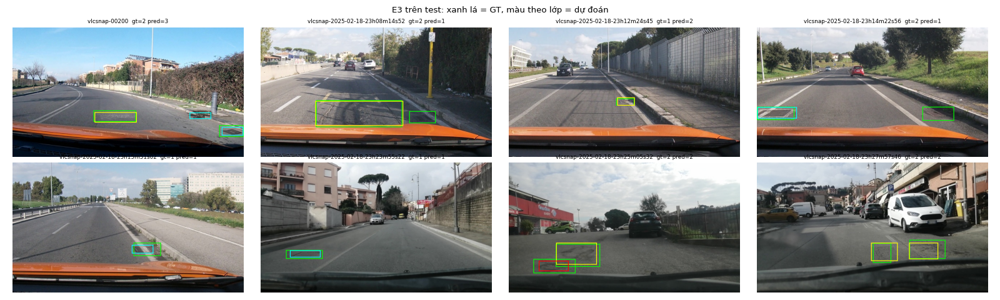

Họ tên: Lương Sỹ Khánh
`dataset_version`: d10-21e4070301

> **Lưu ý trung thực về số liệu.** E0 và E1 trong bảng được chạy khi ViT (kể cả projector) **vô tình bị lượng tử hoá 4-bit**. Lỗi này phát hiện được ở E2 (xem Câu 5). E2 và E3 chạy với ViT fp16 đúng như đề. Bản chạy lại E0/E1 với ViT fp16 và E4 chưa xong vì Colab hết quota GPU. Các ô "chờ" sẽ được cập nhật khi chạy xong.

## Bảng tổng hợp (số của bạn, lấy từ `report/evidence/*.json`)

| Mã | Setup | Tham số huấn luyện | VRAM đỉnh (GB) | Phút | F1 | CI95 | FP/ảnh | F1 pothole | F1 crack | F1 manhole |
|---|---|---|---|---|---|---|---|---|---|---|
| E0 | zero-shot (ViT 4-bit) | 0 | — | — (suy luận ≈ 12) | 0,083 | 0,058–0,113 | 0,80 | 0,170 | 0,025 | 0,143 |
| E1 | LoRA LLM (ViT 4-bit) | 33.030.144 | 5,77 | 55,8 | 0,253 | 0,214–0,295 | 1,17 | 0,122 | 0,181 | 0,517 |
| E2 | + projector (ViT fp16) | 142.135.296 | 7,93 | 55,6 | 0,357 | 0,316–0,397 | 1,07 | 0,216 | 0,283 | 0,625 |
| E3 | + LoRA ViT (ViT fp16) | 148.426.752 | 8,10 | 65,3 | **0,436** | 0,393–0,480 | 0,98 | 0,322 | 0,353 | 0,687 |
| E4 | `data_size` 0,1 so với 1,0 trên E3 | chờ | chờ | chờ | chờ | chờ | chờ | chờ | chờ | chờ |

Mọi lần huấn luyện: QLoRA NF4, r = 16, α = 32, dropout 0,05, lr 2e-4 (warmup 5%, cosine), batch 2 × tích luỹ 4, 300 bước, fp16 + GradScaler, gradient checkpointing bật. GPU: Colab T4.

## 10 câu hỏi (trả lời bằng **số của bạn**, không chép lại tài liệu)

### Câu 1 — Kiến trúc: ViT, projector và LLM của Qwen3-VL-4B có bao nhiêu tham số mỗi khối, và E1/E2/E3 mỗi cái cập nhật khối nào?
Tôi đếm bằng cách dựng model trên `meta` device. Tổng là 4,438B. **ViT** (`model.visual`) có 415,3M: 24 block cùng patch embedding là 306,2M, `visual.merger` 27,3M, và `visual.deepstack_merger_list` 81,8M (3 merger lấy đặc trưng ở lớp 5, 11, 17). **LLM** (`model.language_model`) có 4,022B, trong đó embedding 389,0M dùng chung trọng số với `lm_head` (`tie_word_embeddings=True`).
- E1 chỉ thêm LoRA vào 252 module của LLM (36 lớp × q, k, v, o, gate, up, down): 33.030.144 tham số.
- E2 thêm việc huấn luyện đầy đủ merger và deepstack: 142.135.296 − 33.030.144 = 109.105.152 ≈ 27,3M + 81,8M.
- E3 thêm LoRA vào 96 module ViT (24 block × qkv, proj, fc1, fc2), tổng 348 module, tăng 6.291.456 tham số.
ViT patch embedding và các block ViT gốc luôn đóng băng.

### Câu 2 — E0: `parse_valid_rate` bằng bao nhiêu, và hai lỗi phổ biến nhất của model gốc là gì (kèm một ví dụ output thô)?
`parse_valid_rate` = 0,920: 25/311 output hỏng, 33 ảnh trả `[]`. Model gốc đã dùng đúng thang 0–1000 và không bọc ```json. Hai lỗi chính:
1. **Bịa box và sai lớp, nhất là crack.** Model vẽ 178 box crack nhưng chỉ 6 box đúng (172 FP, crack F1 0,025). Nó hay "cắt" một vết nứt thành nhiều dải nhỏ liên tiếp, ví dụ `[{"label": "crack", "bbox_2d": [500, 309, 525, 324]}, {"label": "crack", "bbox_2d": [500, 324, 525, 338]}, {"label": "crack", "bbox_2d": [500, 338, 525, 352]}, …`.
2. **JSON hỏng.** Kiểu dải box lặp ở trên chạm `max_new_tokens=256` nên bị cắt giữa chừng, ngoài ra còn lỗi cú pháp, ví dụ `… {"label": "manhole", "bbox_2d": [889, 700, 1000, 776)}]` (dấu `)` thay cho `]`).
Recall rất thấp (0,062): model bỏ sót 547/583 box.

### Câu 3 — Thang 0–1000: nếu chấm output theo pixel (hoặc ngược lại) thì F1 ra sao và vì sao? Bạn đã kiểm chứng điều này thế nào?
Tôi chấm lại cùng file dự đoán của E3 bằng `--coord pixel` (`report/evidence/extra/e3_as_pixel.json`): F1 từ 0,436 rơi xuống **0,000**, `parse_valid_rate` vẫn 1,000, FP/ảnh tăng lên 1,77 (mọi box đều thành FP). E1 cũng vậy (0,253 → 0,000). Lý do: khi coi số 0–1000 là pixel rồi đổi về thang 1000, x bị nhân 1000/640 ≈ 1,56 và y nhân 1000/360 ≈ 2,78. Box bị kéo giãn và lệch hẳn khỏi vị trí thật nên IoU < 0,5 với mọi GT. JSON vẫn hợp lệ nên lỗi này "im lặng": chỉ thấy được qua F1 ≈ 0 trong khi valid ≈ 1. Qwen3-VL dùng thang 0–1000 tương đối vì ảnh được resize động (bội số 32 px). Toạ độ tương đối không phụ thuộc độ phân giải, cùng một vật luôn có cùng toạ độ dù ảnh vào ở kích thước nào, và đó cũng là quy ước model đã học khi pretrain grounding.

### Câu 4 — Mask loss: vì sao chỉ tính loss trên phần trả lời? Điều gì xảy ra nếu tính trên cả prompt và token ảnh?
Một ví dụ dài khoảng 400 token: 220 token ảnh `<|image_pad|>`, khoảng 130 token template và prompt, và chỉ khoảng 40–70 token đáp án. Tôi kiểm tra bằng cách giải mã các vị trí `labels != -100`: kết quả đúng bằng JSON đáp án cộng `<|im_end|>\n`, và prompt là tiền tố đúng của chuỗi đầy đủ. Nếu tính loss trên cả chuỗi thì:
- khoảng 85% gradient dồn vào việc "học thuộc" prompt cố định;
- việc dự đoán token `<|image_pad|>` là vô nghĩa, vì đó chỉ là chỗ giữ chỗ cho embedding ảnh;
- tín hiệu học grounding bị pha loãng và model có thể sinh lại prompt thay vì JSON.
Loss ban đầu (1,7) sẽ không phản ánh chất lượng đáp án.

### Câu 5 — Vì sao không thể huấn luyện đầy đủ projector nếu ViT bị lượng tử hoá 4-bit, và bạn đã xử lý thế nào? Vì sao projector phải ở float32?
Đây là lỗi tôi thật sự gặp. Lần đầu chạy E2, `GradScaler.unscale_` báo `Attempting to unscale FP16 gradients`, và số tham số huấn luyện chỉ là 87.609.344 thay vì khoảng 142M. Phần projector chỉ đếm được 54,6M, đúng một nửa 109,1M, vì `Params4bit` nén 2 trọng số 4-bit vào 1 byte. Nguyên nhân: transformers 5.19 khớp `llm_int8_skip_modules` bằng `re.match` (từ **đầu** tên) hoặc theo hậu tố. Vì thế `"visual"` không khớp `model.visual.merger.linear_fc1`, và **toàn bộ ViT, kể cả projector, đã bị lượng tử hoá**. Trọng số 4-bit là tensor `uint8` đã nén kèm hằng số lượng tử, không phải tham số thực, nên không có gradient đúng nghĩa cho từng trọng số và optimizer không cập nhật trực tiếp được. Chỉ có thể huấn luyện adapter đặt lên trên, không huấn luyện "đầy đủ" được. Cách sửa: dùng `llm_int8_skip_modules=["model.visual", "lm_head"]`, thêm `assert` rằng không còn `Linear4bit` nào trong `visual`, rồi đưa merger và deepstack về float32 trước khi bật `requires_grad`. Sau khi sửa: 142.135.296 tham số, 0 gradient fp16. Phải dùng float32 vì GradScaler không unscale được gradient fp16. Ngoài ra AdamW cập nhật trọng số đầy đủ với lr 2e-4: bước cập nhật nhỏ hơn độ phân giải của fp16 sẽ bị làm tròn mất, và trạng thái m, v ở fp16 dễ tràn hoặc bị mất. LoRA cũng được PEFT giữ ở fp32 vì lý do này. Hệ quả cho bảng: E0 và E1 hiện tại chạy với ViT 4-bit, nên chênh lệch E1 → E2 (+0,104 F1) gộp cả hai hiệu ứng "mở projector" và "ViT fp16 thay vì 4-bit".

### Câu 6 — Split theo phiên quay: vì sao chia ngẫu nhiên sẽ cho F1 cao giả? Số ảnh và số box từng lớp ở mỗi split là bao nhiêu?
Các ảnh là frame cắt từ video, nên hai frame liền nhau gần như trùng khít: cùng ổ gà, cùng nắp cống, chỉ lệch vài pixel. Chia ngẫu nhiên thì gần như mọi ảnh test đều có "anh em sinh đôi" trong train. Model chỉ cần nhớ vị trí box là đạt F1 cao, và F1 đó đo khả năng ghi nhớ chứ không phải khả năng tổng quát hoá sang con đường mới. `prepare_data.py` gom theo phiên (ngày + giờ trong tên file), và tôi đã `assert` không có phiên nào xuất hiện ở hai split.

| Split | Ảnh | pothole | crack | manhole |
|---|---|---|---|---|
| train | 1.422 | 1.074 | 1.750 | 691 |
| val | 276 (2 phiên) | 66 | 470 | 103 |
| test | 311 (3 phiên) | 121 | 299 | 163 |

Phân bố lệch, ví dụ val chỉ có 66 pothole, nên phải đọc F1 theo từng lớp.

### Câu 7 — So sánh E1/E2/E3: mở projector và LoRA trên ViT có đáng không (F1, CI95, VRAM, thời gian)?
- **E1 → E2:** +109M tham số, VRAM 5,77 → 7,93 GB (+2,2 GB: trọng số fp32 của projector cùng hai trạng thái AdamW, 109M × 12 byte ≈ 1,3 GB, cộng gradient; khoảng 0,6 GB còn lại là do bản thân ViT chuyển từ 4-bit sang fp16), thời gian gần như không đổi (55,8 → 55,6 phút). F1 0,253 → 0,357 và CI95 không chồng nhau (0,214–0,295 so với 0,316–0,397). Tuy vậy, như Câu 5 đã nói, chênh lệch này gộp cả việc ViT từ 4-bit thành fp16.
- **E2 → E3:** chỉ +6,3M tham số, nhưng thời gian +17% (65,3 phút) và VRAM 8,10 GB vì gradient phải lan ngược qua 24 block ViT. F1 0,357 → 0,436 (+0,079). Pothole cải thiện nhiều nhất (0,216 → 0,322), FP/ảnh giảm 1,07 → 0,98.
E3 có F1 cao nhất với gần như cùng VRAM với E2 và chỉ thêm 10 phút, nên là lựa chọn đáng nhất. Tuy vậy, mức tăng so với E2 nằm sát biên CI (xem Câu 8). Lý do: box nhỏ (trung vị 0,7% khung hình) cần đặc trưng thị giác tốt hơn, và đó là thứ chỉ chỉnh ViT mới làm được.

### Câu 8 — Tập test có 311 ảnh: khoảng tin cậy rộng thế nào, và điều đó giới hạn kết luận so sánh các setup ra sao?
CI95 bootstrap theo ảnh rộng khoảng ±0,04 (E3: 0,393–0,480, rộng 0,087; E2: 0,316–0,397, rộng 0,081). Hai khoảng của E2 và E3 **chồng lên nhau** một đoạn 0,393–0,397. Hai CI được tính riêng trên cùng một tập ảnh, không phải kiểm định ghép cặp, nên riêng chúng **không đủ để khẳng định E3 > E2**. Cần bootstrap ghép cặp (lấy lại cùng tập ảnh cho cả hai model rồi xem phân phối hiệu F1) mới kết luận được. E0, E1 và E2 thì tách hẳn nhau (CI không chồng). Test chỉ có 3 phiên quay, nên CI cũng đánh giá thấp độ bất định thật khi chuyển sang con đường hay điều kiện ánh sáng khác. Mọi kết luận chỉ có giá trị cho đúng 3 phiên này.

### Câu 9 — Phân tích lỗi theo lớp: lớp nào kém nhất và vì sao (kích thước box, số mẫu, ngữ nghĩa)? Kèm ảnh minh hoạ.
Ở E3, **pothole** có F1 thấp nhất (0,322: TP 33, FP 51, FN 88), sau đó là **crack** (0,353: TP 111, FP 219, FN 188). Manhole tốt nhất (0,687: TP 103, FP 34, FN 60).
- Manhole có hình dạng rõ (tròn hoặc chữ nhật, màu kim loại) và ranh giới sắc, nên box dễ đạt IoU ≥ 0,5.
- Crack là vật thể mảnh, dài, ranh giới mơ hồ. Cùng một vết nứt có thể gán nhãn là một box dài hoặc nhiều box ngắn, nên IoU 0,5 rất khắt khe. Giả thuyết của tôi (chưa đo tách riêng) là phần lớn trong 219 FP là box lệch hoặc chia khác người gán nhãn, chứ không phải bịa hoàn toàn.
- Pothole: train có 1.074 box, nhưng có lẽ tập trung ở một số phiên (giả thuyết, chưa kiểm tra theo phiên). Ổ gà nhỏ, xa camera và trông giống mảng vá, vũng nước hay bóng râm, nên model bỏ sót nhiều (FN 88/121).
Ảnh minh hoạ: `report/figures/e3_pred_vs_gt.png` và `e2_pred_vs_gt.png` (8 ảnh test, xanh lá = GT, màu theo lớp = dự đoán: đỏ pothole, vàng crack, lục lam manhole), `vit4bit_e0_pred_vs_gt.png` (zero-shot) và `train_samples.png` (nhãn train).



### Câu 10 — E4: bạn đổi biến nào, kết quả thế nào, và kết luận có đáng tin không?
Biến được chọn: `data_size`, so 10% (142 ảnh, `random.Random(42).sample`) với 100% ảnh train, trên setup tốt nhất là E3. Mọi thứ khác giữ nguyên, kể cả 300 bước tối ưu, nên bản 10% xem mỗi ảnh khoảng 17 lần thay vì khoảng 1,7 lần. Giá trị 1,0 chính là E3 (F1 0,436, CI95 0,393–0,480), lưu lại dưới tên `report/evidence/e4_data_size_1.0.json` (bản sao của `e3.json`, chỉ đổi `name`). **Bản 10% chưa chạy xong** vì Colab free hết quota GPU. Mã đã sẵn sàng (`python -m lab.run_all e4`) và kết quả sẽ được bổ sung vào `report/evidence/e4_data_size_*.json` cùng bảng ở trên.

## E5 (tuỳ chọn): hàm reward IoU

- Hàm reward: `lab/reward.py`, đúng công thức của GUIDE bước 9 (0 nếu JSON hỏng; 1 nếu cả GT và dự đoán đều rỗng; ngoài ra 0,2 + 0,8·ΣIoU / max(n_gt, n_pred, 1), ghép tham lam cùng lớp với IoU ≥ 0,5, dùng `scripts.score.parse_output` và `iou_xyxy`).
- Test (Python thuần, không cần GPU): `python -m pytest -q lab/test_reward.py` cho kết quả **7 passed**. Các trường hợp: hoàn hảo (= 1,0), JSON hỏng (= 0), sai lớp (= 0,2), thừa box bị phạt qua mẫu số, rỗng (cả 3 tổ hợp), một box khổng lồ không được thưởng (chống reward hacking), IoU một phần và JSON bọc ```json.
- **GRPO chưa chạy** vì hết quota GPU.

## Nhìn lại

- Công cụ chấm **không bắt được lỗi ViT bị lượng tử hoá**: E0 và E1 vẫn ra JSON hợp lệ và F1 hợp lý. Tôi chỉ phát hiện nhờ E2 crash và số tham số huấn luyện lệch đúng một nửa. Bài học: luôn đối chiếu số tham số với con số kỳ vọng và `assert` kiểu module sau khi nạp model, vì tên tham số trong API có thể đổi ngữ nghĩa giữa các phiên bản (`llm_int8_skip_modules` ở transformers 5).
- Môi trường Colab: torchao 0.10 cài sẵn làm PEFT 0.21 lỗi khi gắn LoRA lên `nn.Linear` thường (chỉ lộ ra ở E3), phải gỡ torchao. Session free bị ngắt nhiều lần. Pipeline `lab/run_all.py` ghi dự đoán sau mỗi batch và bỏ qua bước đã xong, nên tiếp tục được mà không mất tiến độ.
- Điều tôi chưa chắc: CI bootstrap riêng từng model không phải kiểm định so sánh. Muốn khẳng định E3 > E2 cần bootstrap ghép cặp, và tôi chưa làm.
